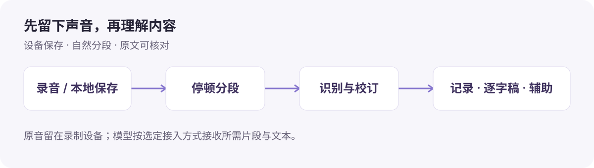

# Lecture Workspace · 记录工作台

**把对话留下，把课堂跟上。**

面向电脑、手机和平板的录音工作台：普通记录、课堂逐字稿与听课辅助各有独立界面，支持切换识别、校订和分析模型。

| 普通记录 | 课堂逐字稿 | 听课辅助 |
| --- | --- | --- |
| 会议、交流与长对话 | 保留完整内容的课堂转录 | 听课时跟进知识点与提问 |
| 分点、分段、角色与原样输出 | 原文、自动校订与人工修改分别保留 | 课堂时间线、页码定位与提问提醒 |
| 保存原音，修改提示词后重新整理 | 打点、回听、搜索、章节与导出 | 并发回答、历史题目与上下文追问 |

## 先保护录音，再处理文字



- 静音跳过仅影响模型输入，录音时间线继续；阈值、等待与前置缓冲可调整。
- 录音中可查看旧记录和设置，采集与转录仍归原会话。
- 设备端周期性保存恢复缓存；刷新后可主动继续录音，不会补造刷新期间的声音。
- 展示模型、用量和费用估算；未取得单价或 usage 时不宣称免费。
- 模型失败保留已有原音和文字，可在限定次数内重试。

流程图为架构示意，不是实际界面截图。

## 本机运行

需要 Python 3.9+。导入音频另需 ffmpeg，读取文字 PDF 另需 pdftotext。

```sh
python3 server.py
```

打开 http://127.0.0.1:8766/ ，在设置中接入自己的模型平台。运行不要求 npm 或 pip；设备端 PWA 的构建和账户网关部署有独立步骤，不能用一个静态服务器替代。

## 数据边界

手机 PWA 的完整录音保存在当前浏览器的 IndexedDB，不是系统“文件”里的普通文件，也不会随文稿同步到服务器。需要长期保留时，请使用原始录音的 WAV 导出。账户网关模式会向选定模型转发所需音频片段和文本。

浏览器刷新、系统挂起、锁屏或退出期间不能保证继续录音；未完成本地提交的末尾音频可能丢失。自动校订与问答可能出错，原文和原音用于核对。费用估算不是账单保证。

## 开发与部署

此仓库是脱敏的源码快照。部署文件中的 `lecture.example.com`、`203.0.113.10` 为占位符，必须替换为自己的域名和服务器；不可直接执行部署脚本。详见 [发布说明](FORK_REPORT.md)。

- 本地服务：`server.py`
- 设备端界面与运行时：`static/`
- 手机构建：`tools/build_mobile.py`
- 账户网关：`cloud_server.py`
- 部署与同步：[DEPLOY.md](DEPLOY.md) · [MOBILE_DEPLOY.md](MOBILE_DEPLOY.md) · [ACCOUNT_DEPLOY.md](ACCOUNT_DEPLOY.md)
- 第三方许可：[THIRD_PARTY_NOTICES.md](THIRD_PARTY_NOTICES.md)

```sh
python3 -m unittest test_sync test_mobile_build
node --test test_mobile_*.mjs
```

当前为私有源码仓库；未授予项目整体的开源许可，第三方组件遵循各自许可证。
